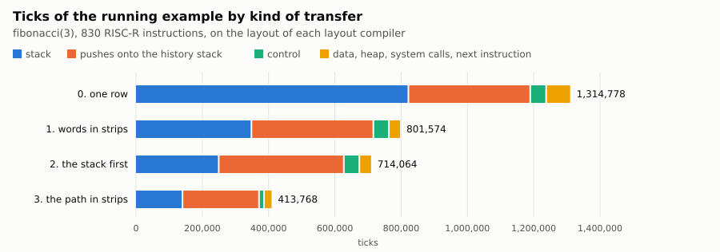
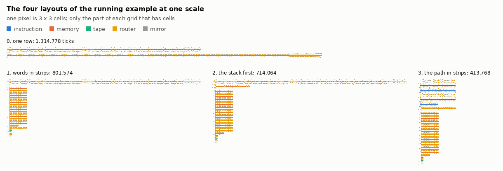
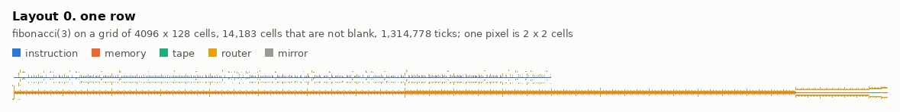
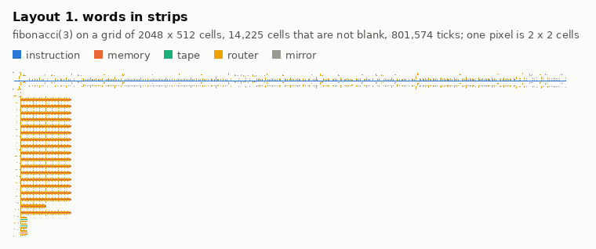
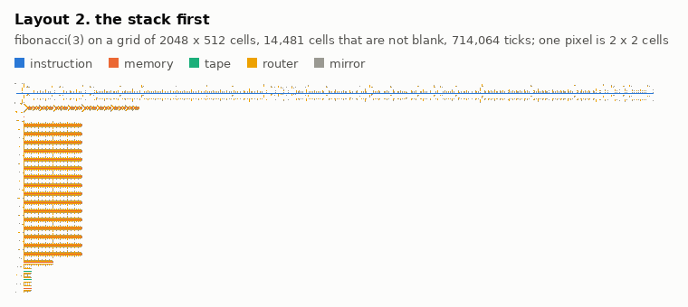
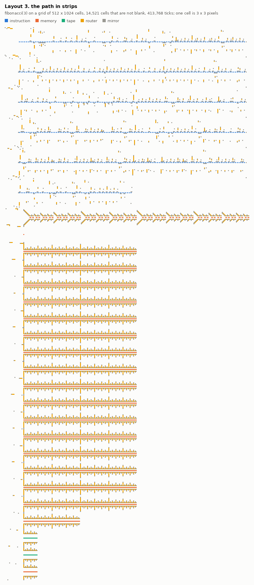
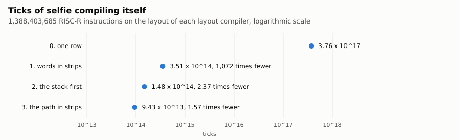

# What Was Optimized, and By How Much

This document explains the optimizations in RISC-R (`riscr.md`) and cellfie (`cellfie.md`) with one running example and with numbers before and after each step. It is kept up to date: a change that moves one of its numbers changes this document in the same commit, and the last section says how each number is reproduced.

Last updated November 24, 2026, at the commit that folds the path.

## The Running Example

`examples/symbolic/recursive-fibonacci-1-10.c` reads one byte, subtracts 46, and computes a Fibonacci number recursively. With the input `1` of `tests/bitr-input.txt` that is `fibonacci(3)`, and the program exits with exit code 1.

```c
uint64_t fibonacci(uint64_t n) {
  if (n <= 1)
    return n;
  else
    return fibonacci(n - 1) + fibonacci(n - 2);
}

uint64_t main() {
  uint64_t  a;
  uint64_t* x;

  x = malloc(sizeof(uint64_t));

  *x = 0;

  read(0, x, 1);

  *x = *x - 46;

  a = fibonacci(*x);

  if (a == 2)
    return 1;
  else
    return 0;
}
```

It is small enough to lay out and run cell by cell, and it has what costs: a heap word, a system call that reads, nested procedure calls, and a stack that is used all the time. Where the example is too small to show an effect, the second column is selfie compiling itself, the largest program there is.

The whole way, from the C\* source to ticks on a grid:

| | Running example | Selfie compiling itself |
| --- | --- | --- |
| RISC-U instructions in the binary | 178 | 43,566 |
| RISC-U instructions executed | 231 | 395,055,649 |
| RISC-R instructions in the binary | 704 | 160,220 |
| RISC-R instructions executed | 830 | 1,388,403,685 |
| History words pushed | 199 | about 260 million (2GB) |
| Ticks, first layout compiler | 1,314,778 | 376,091,754,479,047,372 |
| Ticks, now | 413,768 | 94,297,978,686,148 |
| Ticks per RISC-R instruction, first and now | 1,584 and 499 | 271 million and 68,000 |

## Part 1: RISC-R

### What Reversibility Costs

A RISC-U program overwrites registers and memory. A reversible program may not, so `riscr -t` translates each RISC-U instruction into RISC-R instructions that push what would be overwritten onto a history stack. For the running example:

| Executed | RISC-U | RISC-R | Factor |
| --- | --- | --- | --- |
| instructions | 231 | 830 | 3.6 |
| of which access memory (`ld`, `sd`) | 73 | 345 | 4.7 |
| of which transfer control | 30 | 45 | 1.5 |
| words of history | 0 | 199 | |

The second row is the one that matters on a grid: a reversible program accesses memory almost five times as often, and 199 of its 345 accesses are pushes onto the history stack. Everything in Part 2 is about the distance to memory for that reason.

Backward, the same 830 instructions run in reverse and restore the initial state bit for bit (`riscr -rev`), without a trace.

### What Keeps the Cost Down

The numbers in this section are counted from the trace of the 231 executed RISC-U instructions by the rule that translates each (the table in `riscr.md`). The "without" column is what the simpler rule would cost, computed, not measured: the alternatives were never built.

| Decision | Applies to | With | Without |
| --- | --- | --- | --- |
| Updates in place: `addi rd,rd,imm`, `add rd,rd,rs`, `sub rd,rd,rs` are already reversible | 55 instructions | 55 instructions, 0 words of history | push first: 165 instructions, 55 words |
| A call costs no history in the end: the slot of the pushed `ra` is freed after the return | 8 calls | 0 words net | 8 words |
| `addi rd,rs1,imm` adds `rs1 + imm`, so a register move into a zeroed register is one instruction | 24 moves | 24 instructions | 48 instructions |

In total the example pushes 199 words where pushing every overwritten value would push 262, a quarter more, and executes 830 instructions instead of about 960.

Three more decisions have no "without" that could run at all, so they have no number:

- **`mul`, `divu`, `remu`, `sltu` flip bits (`rd ^= f(rs1, rs2)`).** They are their own inverses. With `rd += f` no forward program could uncompute a comparison, and every loop would leak a register per iteration. The example executes 8 of them.
- **A taken transfer lands after its come-from.** The come-from of a branch is another branch, the same instruction, and no register says where the program came from; a join pushes one flag per pass, whatever the number of its origins. On a grid this is what makes one kind of cell serve as both ends of a wire.
- **Results of system calls are added into `a0`** and recomputed from the tapes backward, so a `read` or `write` needs no history beyond its tape.

### The Size of the History Stack

The translated program allocates its history stack at the start of the heap with one `brk`: 3GB by default, or `riscr -history <MB>`. For riscr the size costs nothing. For a model or a grid every word is a state or a cell:

| | History region | Words used | Strips of words on the grid |
| --- | --- | --- | --- |
| Running example, `-history 1` | 1MB | 199 | 22, with cells for 2,048 words of it |
| Selfie, default | 3GB | about 260 million | 4,195 |

Selfie's heap proper lies behind the third of the history region that is never used. That is the largest known cost that is still there, see the end.

## Part 2: Cellfie's Layouts

On cellfie a program is cells on a grid and one token. An instruction costs one tick where the token is, but every `ld`, system call, branch, jump, call, and return sends the token over wire to another cell, at one tick per cell. The layout compiler decides how far that is. All four layouts below compute the same thing: each is checked against rotor's model of the binary at every instruction (`make layouts`), and none changed the cell rule.

### The Four Layouts of the Running Example

| Layout | Grid | Cells that are not blank | Ticks | per instruction |
| --- | --- | --- | --- | --- |
| 0. One row of instructions, one row of words | 4096 x 128 | 14,183 | 1,314,778 | 1,584 |
| 1. Words in strips, no wire around the torus | 2048 x 512 | 14,225 | 801,574 | 966 |
| 2. The stack first and descending | 2048 x 512 | 14,481 | 714,064 | 860 |
| 3. The path in strips | 512 x 1024 | 14,521 | 413,768 | 499 |

The same run by kind of transfer, in average ticks per transfer:

| Transfer | How often | Layout 0 | 1 | 2 | 3 |
| --- | --- | --- | --- | --- | --- |
| to the next instruction | 454 | 2 | 2 | 2 | 3.9 |
| control: branch, jump, call, return | 29 | 1,657 | 1,615 | 1,615 | 513 |
| push onto the history stack | 199 | 1,847 | 1,848 | 1,897 | 1,161 |
| stack | 132 | 6,245 | 2,657 | 1,909 | 1,080 |
| data, heap, and system calls | 15 | 4,922 | 2,350 | 2,448 | 1,563 |

Read down a column to see where a layout spends its ticks, and along a row to see which step helped which transfer. The same as a chart, in total ticks:



And the four layouts themselves, as the compiler of each step lays the running example, at one scale:



Each step is explained below, with a schematic and the actual layout.

### Layout 0: One Row

The first compiler (M8) laid the instructions in one row and the words in another, each word in a column of its own, and connected them through three columns at the western edge and around the torus.

```
          columns 0-2      instructions, every other column  ---------->
row       +---+----------------------------------------------------------+
combs     | s |  /\/\/\ combs of control and of returns from memory      |
path      | p |  I  I  I  I  I  I  I  I  I  I  I  I  I  I  I  I  I  ...  |
combs     | i |  \/\/\/ combs of arrivals and of departures to memory    |
          | n |                                                          |
words     | e |  D  H  H  H  H  H  H  ... history ...  H  h  S  S  S  T  |
          | s |  one column per word, by address: data, heap, stack last |
          +---+----------------------------------------------------------+
            ^ every transfer goes west to a spine, around the torus, and back east
```



The blue row is the path, the orange row the words, the yellow and gray cells the routers and mirrors of the combs. The words reach further east than the instructions: 2,289 columns of them, the stack at the far end.

A leg from an instruction in column *x* to the word in column *w* and back took *H* + 2*x* + 2*w* - 4 ticks on a grid of height *H*: the token goes west to the root of a comb, east to the word, west again, and east again. The stack has the highest addresses, so it is in the last columns: 6,245 ticks for an average access to the stack in the running example, where the grid is 4,096 columns wide.

For selfie the row of words is 550 million columns. An access to the stack costs about a billion ticks, and the run 3.76·10^17: 271 million ticks per instruction, twelve years at a nanosecond per tick.

### Layout 1: Words in Strips

A row of *N* words puts the last word *N* columns away. A square of *N* words puts it about the square root of *N* away. The compiler now lays the words in strips: the lower bits of a word address select the column, the bits above select the strip, and a comb on its side selects the strip as the combs above the words select the column. Wire no longer goes around the torus but turns in two rows north of the path.

```
     instructions ---------------------------------------------->
     +----------------------------------------------------------+
     |  I  I  I  I  I  I  I  I  I  I  I  I  I  I  I  I  I  ...  |
     +----------------------------------------------------------+
  c  +---------------------+
  o  | D  H  H  H  H  H  H |  strip 0    the lower bits of the
  m  +---------------------+             address select the column,
  b  | H  H  H  H  H  H  H |  strip 1    the others the strip
     +---------------------+
  o  | ...                 |
  n  +---------------------+
     | h  h  .  .  .  .  . |
  s  +---------------------+
  i  | .  .  .  .  S  S  S |  last strip: the stack, its top in
  d  +---------------------+  the far corner
  e
```



The words are now the block in the southwest, 22 strips of 128 columns, each an orange row with its two combs; the path is still one row.

| | Running example | Selfie |
| --- | --- | --- |
| Strips, and words per strip | 22 of 128 | 4,195 of 131,072 |
| Ticks before | 1,314,778 | 3.76·10^17 |
| Ticks after | 801,574 | 3.51·10^14 |
| Factor | 1.6 | 1,072 |

The factor is the size of memory: 2,289 words are not far apart in a row either, 550 million are. In the running example the stack gains most, 6,245 to 2,657 ticks per access, because it was the far end of the row. A push onto the history stack costs what it did: the history begins at the near end in both layouts.

### Layout 2: The Stack First

Selfie's run was measured before the next step. Of 647 million legs to a word, 39% go to the stack, 54% to the heap, most of them pushes onto the history stack, and 6% to the data segment. The stack was in the far corner, and for a reason that no reordering of regions fixes: a router turns a token if a bit of its address is set, so in any comb the words with a bit set are further from the root, and the top of the stack is where all bits are set.

The fix turns the token first. A token that is heading south when it meets the router is turned east if the bit is set, and south is where all others go:

```
   comb as before: set bits are far        the stair to the stack: set bits are near

   -->R-------->  bit clear: near          -->\
      |                                        R-->\         bit set: on down the stair,
      |                                        |   R-->\     a row and a column per bit
      \-------->  bit set: far                 |   |   R-->  the stack, first
                                               |   |   |
                                               |   |   \-->  bit clear: these leave the
                                               |   \------>  stair south, to strips
                                               \---------->  placed after the stack
```

With the stair, the strips of the stack are first and all others follow by ascending address. Within the stack, strips and words descend the same way, so the top of the stack is the first word of the first strip.



The first strip of words is now the stack. It is twice as wide as the others, since each of its routers takes a column, and its combs look different: they are the stair.

| | Running example | Selfie |
| --- | --- | --- |
| Ticks before | 801,574 | 3.51·10^14 |
| Ticks after | 714,064 | 1.48·10^14 |
| Factor | 1.12 | 2.37 |
| Average access to the stack, before and after | 2,657 and 1,909 | |

Everything else pays a little for it, as the table of transfers shows: a push costs 1,897 ticks instead of 1,848, since the strips of the stack are now in front of the history. For selfie the trade is 39% of all legs made short against 61% made a few hundred rows longer.

### Layout 3: The Path in Strips

After layout 2, two fifths of what selfie's run cost was the way along the path: every transfer goes to the root of a comb at the western end of the path and back, 90,000 ticks per leg where the path is 320,000 columns long. So the path is laid as the words are: the lower bits of an instruction address select the column, the others the strip, each strip has its own four combs, and four combs on their side collect and deliver control and the tokens to and from memory. From the end of a strip the path leads around to the start of the next.

```
  side    +------------------------------+
  combs   | combs north                  |
          | I  I  I  I  I  I  I  I  I  I |--\   strip 0 of the path
   ||     | combs south                  |  |
   ||   /-------------------------------<---/   the path returns west
   ||   | +------------------------------+
   ||   \>| I  I  I  I  I  I  I  I  I  I |--\   strip 1
   ||     +------------------------------+  |
   ||     ...                            <--/
   ||
   ||     +---------------------+
   \\====>| S  S  S  S  S  S  S |   the strips of words, south of
          +---------------------+   the strips of the path,
          | D  H  H  H  H  H  H |   the stack first
          +---------------------+
          | ...                 |
```



Six blue strips of the path, each with its combs north and south, the combs on their side west of them, and south of them the strips of words as in layout 2, the stack first.

| | Running example | Selfie |
| --- | --- | --- |
| Strips of the path, and instructions per strip | 6 of 128 | 79 of 2,048 |
| Rows per strip | 34 | 52 |
| Ticks before | 714,064 | 1.48·10^14 |
| Ticks after | 413,768 | 9.43·10^13 |
| Factor | 1.73 | 1.57 |
| Average control transfer, before and after | 1,615 and 513 | |

Control gains most, a factor of three, since both ends of a control transfer are on the path. The step has a price that the first row of the table of transfers shows: going on to the next instruction took 2 ticks and now takes 3.9 on average, because at the end of a strip the token walks back west, 294 ticks in the example. And the first accesses of a run got slower, since the words are now south of all strips of the path: the first access to the stack took 600 ticks in layout 2 and takes 942 in layout 3. On average it is 1,080 instead of 1,909.

### All Steps, for Selfie



| Step | Ticks | Factor | Ticks per instruction | At 1ns per tick |
| --- | --- | --- | --- | --- |
| 0. one row | 376,091,754,479,047,372 | | 271 million | 12 years |
| 1. words in strips, no torus | 350,763,823,005,762 | 1,072 | 253,000 | 4 days |
| 2. the stack first | 148,280,941,906,994 | 2.37 | 107,000 | 41 hours |
| 3. the path in strips | 94,297,978,686,148 | 1.57 | 68,000 | 26 hours |
| all | | 3,988 | | |

The instructions executed are the same 1,388,403,685 in every row, and the binary selfie writes is the same, byte for byte.

## Part 3: What Makes This Checkable

Three more changes are not about how fast a program runs on the grid but about being able to say that it runs correctly, and how far the token travels.

| Change | Before | After |
| --- | --- | --- |
| The model of the cell rule as a decision tree, by cell kind, then path or side, then instruction, instead of one chain of conditions per state | 155,363 paths and 2 minutes 39 seconds for bitr to prove one direction of the bijection | 80 paths and a quarter of a second (about 160 paths now, with system calls) |
| Bitr's product of rotor's model and cellfie's model collects the lines it evaluates once instead of scanning all lines every tick | 74 seconds for the smallest example | under 2 seconds |
| Hybrid simulation: the cells that compute act by the cell rule, the wire is measured, not followed | selfie cannot be laid out at all: 550 million words, 10^14 to 10^17 ticks | 5 minutes of the host for all 1,388,403,685 instructions |

The hybrid simulator is what the numbers for selfie in this document come from. It is tied to the event-driven simulator by `make hybrid`: on the 17 symbolic examples that exit, the running example among them, both stop with the same exit code after the same number of instructions and the same number of ticks, for every layout above.

Cells that know their address (tags, `invalid-address` and `invalid-pc`) are not an optimization, but every layout step relied on them: a token that a new comb sends to the wrong word stops there instead of computing something else.

## What Is Not Optimized

- **The history stack.** 54% of selfie's legs go to the heap, most of them pushes, each a word further into 2GB of strips that take 39 rows for one row of words. No placement helps a region that is used once from end to end. A smaller region, checkpointing, or a code generator that leaves less garbage (M9) would.
- **The heap behind the history.** Selfie's own heap begins after the 3GB region of which 2GB are used. It is a gigabyte of empty strips away.
- **Hot code and hot data.** Instructions are in the order of their addresses and regions in a guessed order, stack first. Nothing is profiled.
- **Density.** A strip of words takes 2*h* + 3 rows for one row of words, 39 for selfie, because each strip has its own two combs.
- **The translation.** For selfie, 3.5 RISC-R instructions and 0.65 words of history per RISC-U instruction, for the running example 3.6 and 0.86: that is what `riscr -t` does to code that starc wrote for an irreversible machine.

## How the Numbers Are Reproduced

The running example, as RISC-U and as RISC-R:

```
./selfie -c examples/symbolic/recursive-fibonacci-1-10.c -o fib.m -m 1 < tests/bitr-input.txt
./riscr -l fib.m -history 1 -t fib.r
./riscr -l fib.r -rev 1 < tests/bitr-input.txt
```

The running example on a grid, event-driven with `-c` and `-rev`, hybrid with `-h`:

```
./cellfie -heap 0 2048 -heap 1048576 64 -stack 128 -i tests/bitr-input.txt -c fib.r -o fib.rle -rev 100000000
./cellfie -heap 0 2048 -heap 1048576 64 -stack 128 -i tests/bitr-input.txt -h fib.r
```

Selfie: `make selfie-on-cellfie`. All examples, against rotor's model and hybrid against event-driven: `make layouts` and `make hybrid`.

The layouts are the layout compilers of these commits of `tools/cellfie.c`, each built with the current `selfie.h` and its own `tools/btor2.h`:

| Layout | Commit | Date |
| --- | --- | --- |
| 0. one row | `cdf037e` | November 23, 2026 |
| 1. words in strips, no torus | `78dc61f` | November 23, 2026 |
| 2. the stack first | `f5a3cd6` | November 23, 2026 |
| 3. the path in strips | `5d76d28` | November 24, 2026 |

The figures are rendered by `python3 figures/render.py`, which builds the layout compiler of each commit, compiles and runs the running example on it, and draws the layouts, cell by cell, and the charts; it prints the numbers of the table of transfers. For that table the event-driven simulator of each commit prints the ticks whenever the token is on the path of an instruction cell, and each step is classified by the address it accesses. A new layout is a new line in the script's list of layouts and in the table above; the ticks of selfie in the script are those of this document. The counts in Part 1 are from `./selfie -l fib.m -d 1` and the instruction profiles that selfie and riscr print.
