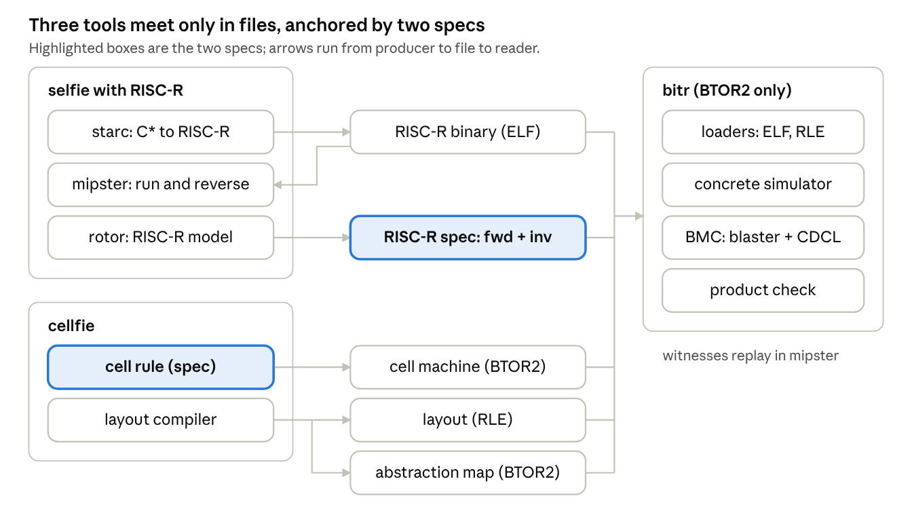
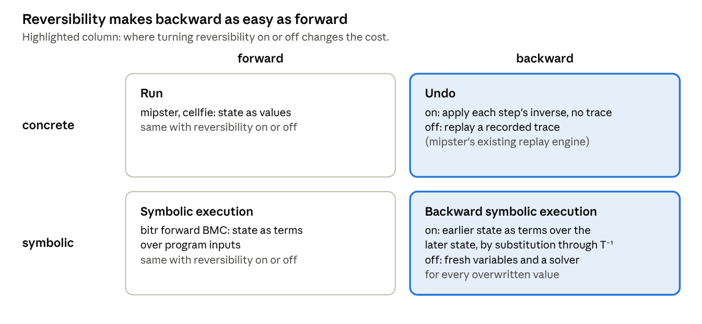

# selfie · cellfie · bitr — development plan

Oct 30, 2026 · Christoph Kirsch · updated Nov 6, 2026: M2 done; Nov 5: M16 garbage-free riscr, M17 reversible hypster; Nov 2: RISC-R moved into its own tool, riscr

## Goal and design rules

Build three C\* tools that evolve side by side: selfie extended with RISC-R through the tool riscr, cellfie (an instruction-level reversible cellular machine that runs RISC-R), and bitr (a bounded model checker for BTOR2). They are linked only by files, and there is exactly one executable spec per model of computation. The aim is to show that cellfie is possible and that it sharpens how selfie is taught, not to compete on performance.

Rules every change must obey:

1. **C\* only.** Every tool compiles with selfie and with gcc, and runs on mipster, exactly as rotor and babysat do today.
2. **One file per tool**, using `selfie.h` as its library. Shared code becomes one header, the way `selfie.h` is shared now.
3. **One spec per model of computation.** RISC-R semantics live in rotor's RISC-R machine model; cellfie's cell rule is RISC-R per cell plus token movement, checked against that model. Everything else is checked against these two, never the other way round.
4. **Files are the only interfaces:** ELF binaries, RLE layouts, BTOR2 models. No tool calls into another tool's internals.
5. **Extend, don't fork.** RISC-R reuses RISC-U's 14 opcodes and encodings, marks its binaries with one ELF flag, and lives in its own tool, riscr, on top of `selfie.h`; `selfie.c` only learns to refuse RISC-R binaries. Existing behaviour, make targets and grader tests stay unchanged.
6. **Every milestone ends in a check a machine runs**, as a make target, not a claim.
7. **Deferred on purpose:** asynchrony, hardware targets, performance. Each stays a separate layer that can be added later.
8. **Reversibility is a switch.** Every tool runs with RISC-U and with RISC-R, so each benefit and each cost of reversibility shows up by running a program the one way or the other.
9. **Asynchrony stays below the semantics.** All semantics are synchronous steps. Asynchrony enters only as an implementation layer proven to refine them, and only where several signals are in flight.

## Architecture

Selfie and cellfie produce files, and bitr reads them. The only things the tools share are the two specs: rotor's RISC-R model and cellfie's cell rule.

No model is generated per program. Programs and layouts enter bitr only as initial state, through its loaders. The abstraction map is the one file that ties cellfie's cells to RISC-R's `pc`, registers and memory.

RISC-R is the narrow waist. Cellfie runs it directly, one instruction per cell. What changes is that instructions and data sit in space, and the token pays for distance.

## Reversibility and symbolic execution: one picture

Reversibility and symbolic execution are two sides of one property. A step that is a bijection can be run backwards, concretely or symbolically, with the same machinery that runs it forwards. Without reversibility, going backwards needs either a recorded trace (concrete) or fresh variables and a solver (symbolic).

**Turning reversibility off.** Reversibility is a switch, not an assumption. Every tool runs with RISC-U (off) and RISC-R (on), and the same programs run both ways: as RISC-U binaries on mipster and, translated, as RISC-R binaries on riscr. Running a program both ways shows exactly where reversibility enters, and what it costs:

| Aspect | RISC-U (off) | RISC-R (on) | Measured as |
| --- | --- | --- | --- |
| Forward execution | baseline | Bennett history stack and extra instructions | instruction count, history size |
| Concrete backward | needs a recorded trace | runs each step's inverse | trace bytes |
| Symbolic backward | fresh variables and constraints per overwritten value | substitution only | variables, solver time |
| cellfie's cell rule | not a bijection; bitr finds two states with the same successor | a bijection, proven by bitr | bitr's check |
| Physical cost | one Landauer erasure per overwritten bit | no erasure in principle | erased bits counted, as a proxy |

**History is where the difficulty lives.** An irreversible step destroys bits, and going back across it needs them from somewhere: a recorded trace (concrete undo), fresh variables under an existential (symbolic backward), the history stack (Bennett), or, physically, a Landauer erasure each. These are four accountings of one quantity, and the columns of the table above measure it four ways.

History has two parts, and each is one of symbolic execution's two classic difficulties. Data history holds overwritten values, which are the witnesses of the existential that backward symbolic execution needs. Control history holds the bit Bennett pushes at every join to say which way control arrived, which is a branch decision of the path; the control history of a run is its path, and path explosion forward is the number of distinct control histories.

Forward and backward pay differently. Run forward with symbolic inputs, a push copies a term that already exists, a shared pointer in a DAG rather than a new variable; the cost appears later, when uncompute builds `x - e + e` and the engine or the solver must see that it cancels. Run backward from a symbolic state, every pop reads a word nobody has fixed: a free variable.

Bennett overpays. It records every overwrite, including values the program could recompute, while the intrinsic minimum is what the computation destroys, log₂ of the number of preimages. Garbage-free code approaches that minimum. In `c = 0; while (x != 0) { x = x / 2; c = c + 1; }`, each iteration destroys one bit, the low bit of `x`. Bennett pushes 64 bits per iteration plus a control bit for the loop head; garbage-free code saves only the low bit, and its loop-head come-from tests `c != 0`, which needs no history; the intrinsic count is one bit per iteration minus the top bit, which must be 1, so the end state `(x = 0, c = k)` has 2^(k−1) preimages. Backward symbolic execution then introduces 64 fresh variables per iteration on Bennett code, unless the solver discovers that 63 are determined, and one on garbage-free code. The prediction for M15: trace bytes and Bennett history size track each other, while the free backward variables follow the intrinsic count only for garbage-free code. Compression applies to the free bits only: the encoding should keep naming program values as defined variables, since restricting a CDCL solver's decisions to the free bits is provably weaker (Järvisalo and Junttila, 2009).

A conjecture to check against the literature: Bennett checkpointing trades history for recomputation, and BMC encodings make the same trade, from state variables in every frame (every pebble kept) to one term over the initial state (no pebble kept, everything recomputed). If the correspondence holds, the pebbling bounds predict which encodings in between are worth trying in bitr.

Asynchrony stays orthogonal in the same way. All semantics are synchronous steps. In v1 only one cell is active per tick, so synchronous and asynchronous execution coincide, and a clockless implementation needs no synchronizer at all. Asynchrony first matters once several signals are in flight: several tokens, v2's bit-level regions, or level 4 of the story. There it enters as a synchronizer layer below the semantics, proven to refine the synchronous steps.

## RISC-R: riscr on top of selfie

RISC-R keeps RISC-U's 14 opcodes and encodings and changes only what they mean, so selfie's encoder, decoder and disassembler serve both. RISC-R lives in one tool, riscr (`tools/riscr.c`), built on `selfie.h` and laid out like `selfie.c`: library, compiler, interface, architecture, runtime. `selfie.c` only decodes the ELF flag and refuses to run RISC-R binaries, so selfie behaves exactly as today. M1 first put RISC-R into `selfie.c` behind a flag, which added about 1,380 lines to a file that must stay small enough to teach from; moving it into riscr (November 2, 2026) left about 10.

**The ISA, one rule per instruction class:**

| RISC-U | RISC-R meaning | Why it is reversible |
| --- | --- | --- |
| `add sub` | `rd += rs1 + rs2` and `rd += rs1 - rs2`, with `rd` distinct from `rs1` and `rs2` | each is the other's inverse (the Janus trick) |
| `mul divu remu sltu` | `rd ^= op(rs1, rs2)` | executing the same instruction again restores `rd`; with `+=` no forward program could uncompute a product or a comparison |
| `addi lui` | `rd += rs1 + imm` and `rd += imm * 2^12` | inverse is the same instruction with the negated immediate |
| `ld`, `sd` | `ld` = exchange `rd` with a memory word; `sd` throws | an exchange is its own inverse |
| `beq` | a taken branch lands after a paired come-from `beq` at its target | the pair tells reverse execution which way it came (Pendulum's idea) |
| `jal jalr` | `jal` adds the return address into a zeroed `rd`; `jalr rd,0(rd)` is both the come-from of a call and the return, and uncomputes `rd` | the link is uncomputed by the instruction that consumes it |
| `ecall` | `exit`, `read`, `write`, `openat`, `brk`, with arguments in `a1-a3` and the result added into `a0`; files are tapes in machine state | no information leaves the state |

This table summarises `riscr.md`, which is authoritative; the M1 decisions behind it are recorded in `CLAUDE.md`.

RISC-R binaries look like RISC-V but do not run on RISC-V hardware, so bit 8 of `e_flags` (`EF_RISCR`) marks them: mipster refuses them, and riscr refuses binaries without it.

One more ISA rule: the code segment is read-only. Fixing a program's code then keeps the step function a bijection on the remaining state, which is what tier-2 compilation relies on.

**The compiler, in two steps:**

1. **Bennett mode (no language change).** Every RISC-U instruction that overwrites a register or memory word first exchanges the old value into a fresh zero slot on a history stack, then computes into the zeroed destination; every branch target records which way control arrived. All of C\*, including selfie itself, then runs as RISC-R unchanged. (The plan first described this per assignment, with temporaries uncomputed at statement end; M2 built it per instruction, see below.)
2. **Garbage-free mode (small language change).** Add only `x += e`, `x -= e` and `x ^= e` to C\*, with `x` not occurring in `e`. These compile without touching the history stack. `^=` is needed because M1 made `mul`, `divu`, `remu` and `sltu` exclusive-or into `rd`, so a product or comparison can only be uncomputed by `^=`. All three remain valid C, so selfie still compiles with gcc. Reversible conditionals and loops (Janus `fi`/`until`) are not C, so they stay out of M9; M16's opcode dispatch is the first clear need for one, and M16 provides it.

**Where the compiler lives (decided November 6, 2026).** Bennett mode is the translator `riscr -t` from RISC-U binaries to RISC-R binaries in riscr's compiler section, so starc stays unchanged and the ELF binary is the only interface between them. The translator pushes every overwritten register and memory word onto the history stack, gives every jump target a come-from, and records in a pushed flag which way control arrived; the scheme is in `riscr.md`. Compute, copy, uncompute happens once for the whole run: `-rev` runs forward and back while the output stays on its tape. The price is history per instruction rather than per assignment: measured on selfie compiling itself, 0.65 words per executed RISC-U instruction, 2GB in total, at 3.5 RISC-R instructions per RISC-U instruction. In-place updates (`addi sp,sp,-8`, `add t0,t0,t1`) are recognised from the code and cost no history; updates through memory are not, because `x += e` and `x = x + e` compile to the same RISC-U code, so M9 needs either a marker that starc emits or a code generator in starc after all.

**The emulator.** Riscr reuses mipster's loader, memory, contexts and decoder and has its own run loop, as monster does. It runs RISC-R binaries forward (`-m`) and, without any trace, backward (`-rev`), executing each instruction's inverse directly. Mipster's replay engine, by contrast, undoes RISC-U instructions from a recorded trace (`execute_undo`, with `undo_ecall` still a TODO). Comparing the two is a lesson in its own right: undo with a trace is Bennett in the emulator, undo without a trace is reversibility in the ISA.

**The model.** Rotor already generates machine models without code. Add RISC-R forward and inverse machine models, both program-independent, with the program break and tapes as named state; the history stack is a memory region that translated code manages, not machine state. That pair becomes the RISC-R spec.

## bitr: a BTOR2-only bounded model checker in C\*

Bitr reads BTOR2 and nothing else, so it never needs to know whether a model came from selfie, cellfie or anywhere else. It is one C\* file, `tools/bitr.c`, built up in layers. Each layer is a mode of the same tool and is checked before the next one starts.

1. **Parser** for the BTOR2 subset rotor emits: bit-vector and array sorts, constants, operators, `state` / `init` / `next`, `input`, `bad`, `constraint`. bitme's `btor2.py` serves as the reference parser for differential tests.
2. **Loaders** that only turn data into `init` fragments, the write chains rotor already produces. One loader takes an ELF binary (RISC-U or RISC-R), the other an RLE layout for the CA grid. No semantics lives here.
3. **Concrete simulator**, the counterpart of btorsim. Rotor's existing evaluator (`eval_line`) moves into a shared header, `tools/btor2.h`, used by both rotor and bitr. That keeps rotor out of bitr as a tool while sharing the code as a library, the way `selfie.h` is shared. The first real check: mipster and the simulator run the same binary and produce the same state at every step.
4. **Bit-blaster** to CNF using Tseitin encoding. Arrays are handled by read-over-write elimination, which works because k is bounded, together with rotor's existing options for bounding memory segments.
5. **SAT core.** Babysat stays as the executable spec (plain enumeration). Next to it goes a minimal CDCL solver in C\*: two watched literals, first-UIP learning, restarts only if needed. Both must give the same SAT/UNSAT answer on `examples/sat` and on every CNF bitr generates.
6. **Forward BMC:** unroll k steps and check `bad`. A satisfying assignment becomes an input trace that mipster or riscr replays, which closes the loop.
7. **Backward BMC on the inverse model:** unroll from `bad` backwards to `init`, where each step is plain substitution with no quantifiers. Backward unrolling is functional but not concrete: `init` is mostly concrete (loaded code, zeroed registers), so forward terms collapse under constant propagation, while `bad` constrains a few bits and leaves the rest of the state free. The likely win is therefore meet-in-the-middle, forward from `init` and backward from `bad`, joined on the property's cone of influence rather than on the full state. Whether either beats forward BMC on real programs is a research question, not an assumption.
8. **Product machine:** two BTOR2 models plus an abstraction function, also in BTOR2, give an equivalence check. This is how selfie and cellfie are compared, and it is fully generic.
9. **Escape hatch:** export the unrolled formula as DIMACS or SMT-LIB, or hand the BTOR2 file straight to btormc, Pono or bitme, for anything beyond toy size.

**Specialisation, later (`bitr -specialize`).** Needed only for levels 3 and 4 of the story. Given a model and constant code, this mode partially evaluates the model into a smaller one, then applies scalar replacement. Every pass goes from BTOR2 to BTOR2, and the product machine checks it against its input. Optimisation uses cheap solver-backed passes by default: SAT sweeping, and removing logic that k-induction proves dead.

**The BTOR2 profile.** BTOR2 itself stays unextended. A short convention document fixes three things: symbol names for architectural state (`pc`, registers, memory segments including the history stack's, program break, tapes); file pairs for forward and inverse models; and the abstraction function as a separate file over cellfie's state.

**Realism.** A naive CDCL solver on bit-blasted RISC-R handles programs of a few dozen instructions at small k. That is enough for teaching and for the selfie-versus-cellfie checks on small cases. Research-scale results go through the escape hatch.

**Propagation by emulation, later.** Whenever the solver has assigned every bit of one frame's state, a propagator computes the neighbouring frames by running the step function forward and, on the inverse model, backward, and assigns them; a computed bit that disagrees with an assigned one is a conflict. Tseitin-encoded arithmetic cannot propagate from outputs back to inputs; the inverse model can. This generalises bitme's domain propagation to both directions. In bitr's own CDCL it is a propagation hook; with an external solver it maps onto CaDiCaL's IPASIR-UP user propagators. Research question: how often frames become fully assigned early enough to matter, and whether propagating on the cone of influence of the assigned bits recovers most of the benefit when they do not.

**Research notes on reversible model checking.**

- **Predecessors in IC3.** On a bijection every full state has exactly one predecessor, so a predecessor query for a full state is one backward step and a membership test, with no SAT call. Cubes, which leave bits free, still need the solver for those bits. Open: what share of IC3's queries are on full or nearly full states, and whether generalisation can exploit the uniqueness of predecessors.
- **Reachability is symmetric.** A bijection on a finite state space is a permutation, so the state space is a union of cycles. M1 made `exit` and exceptions leave the state unchanged, so they are fixpoints and riscr's whole step stays a bijection. A bad state is then reachable from `init` exactly when `init` is reachable from it, and a checker may start from whichever end is more constrained. This holds only for the full state, tapes included, and only within the models' memory bound; cycles can be astronomically long, so it says nothing about depth.
- **Information as proof size.** The amount of information a solver must produce for an unsatisfiable instance is the log of its shortest proof in the proof system the solver simulates: resolution for CDCL (Pipatsrisawat and Darwiche showed CDCL with restarts simulates resolution, and every CDCL run yields a resolution proof), extended resolution once defined variables count. It predicts solver time in both directions but cannot be computed: even approximating minimal resolution proofs is NP-hard (Atserias and Müller, 2019). For satisfiable instances the analogue is the smallest learning-sensitive backdoor (Dilkina, Gomes and Sabharwal, 2009). The measures in this plan approximate it from different sides: free bits are a strong backdoor relative to propagation, which is running the step function, so k free bits bound the proof by about 2^k times a polynomial; defined bits change the proof system, and keeping the program's own names bets that a short proof uses them as extension variables; resolution width bounds proof size from below (Ben-Sasson and Wigderson); influence, def-use fan-out and simulated equivalences guess which variables a short proof uses. After a run the notion becomes measurable: the solver's DRAT proof, trimmed with drat-trim, bounds the proof size from above, and the variables it mentions, mapped back to rotor's state names and unrolled steps, are the information the solver used and where. Each heuristic is then judged by how well it predicts those variables across instances.

## cellfie: an instruction-level cellular machine for RISC-R

Cellfie is one C\* file, `tools/cellfie.c`. Each cell holds one RISC-R instruction, one memory word, or a piece of wire. A single token carries `pc` and the register file from cell to cell. The cell rule is simply RISC-R semantics applied where the token is, so there is no microcode and no interpreter layout. The machine is synchronous and reversible. V1 is deliberately coarse; bit-level cells come later as a checked refinement.

**Cells and token.**

- **Instruction cell:** one RISC-R instruction plus an outgoing direction. When the token enters, the cell applies the instruction to the token's registers and passes the token on.
- **`beq` cell:** two outgoing paths, chosen by the condition. Its paired come-from cell sits where the paths merge, so reverse execution knows which way the token arrived.
- **Wire cells:** move the token one cell per tick, including turns and crossings. `jal` and `jalr` route the token along wires, steered by address bits.
- **Memory cells:** one 64-bit word each. `ld` (exchange) sends the token to the word and back.
- **Tape cells:** input and output for `read` and `write`, following RISC-R's system-call model.

**Rule and reversibility.** The rule is a bijection because every instruction is a bijection on the registers and every wire move is a permutation. Bitr checks this symbolically: rotor's per-instruction inverses give the inverse rule, and inverse after rule must be the identity. Only the token's cell changes per tick, so an event-driven simulator costs path length per instruction.

**Reversibility off.** Cellfie also accepts RISC-U layouts, whose instruction cells overwrite `rd`. That rule is not a bijection, and bitr's check finds two states with the same successor. Running backwards then needs a recorded trace. This is the switch from rule 8, at cell level.

**Formats.** A layout is RLE extended with cell contents (instruction words, memory words). `cellfie -btor2` emits the cell machine as BTOR2 for a given grid size. Layouts enter only as `init`, through bitr's loader.

**Layout compiler.** It turns a RISC-R binary into a layout. Instructions go along a path in program order, branch and jump targets are connected by wire, and memory sits as a region beside the code. Code layout is the performance model: distance is time.

**Equivalence with selfie.** An instruction boundary is the token entering an instruction cell. The abstraction function is direct: `pc` is that cell's address, the registers are the token's payload, memory is the memory cells. Bitr's product check against rotor's RISC-R model holds at every step, and any program can be compared with riscr.

**Running all of selfie.** Event-driven simulation costs tens to thousands of ticks per instruction, mostly memory round trips. Selfie's self-compilation, around 10⁸–10⁹ instructions, should then take hours when run natively. That needs measuring. Hybrid simulation stays as the fallback: abstract RISC-R steps wherever nobody is watching.

**Constructor and tape.** Loading a program means constructing it. A constructor token reads a tape and writes instruction and memory cells into blank space. The tape is kept, so the global map stays injective. The layout compiler is the shortcut that writes the same cells directly. Self-replication, a program that writes a copy of its own cells, follows Avida's precedent.

**The three selfie analogies:**

| Analogy | cellfie version | Target |
| --- | --- | --- |
| Self-compilation | the layout compiler, compiled by selfie to RISC-R, runs on cellfie and reproduces its own layout: L1 = L0 | M11 |
| Self-execution | all of selfie runs on cellfie, cell by cell | M13, pending the speed measurement |
| Self-hosting | the constructor builds guest programs in walled regions; replication = it builds itself plus its tape | after M10 |

**Later layers**, each checked by bitr against the layer above:

1. **Concurrency.** Several tokens act as threads, each carrying its own register file as its thread context. After that comes a dataflow variant in which operand tokens flow between instruction cells, as in WaveScalar; that is the parallel tier 2.
2. **Register liveness.** The layout compiler knows which registers are dead along a path, so the token can drop them and pick them up again later. Register allocation becomes deciding what to carry. Not in v1, because it makes the token's shape vary along the path and complicates the cell rule.
3. **Bit-level refinement (v2).** Each v1 cell kind (instruction, `beq`, come-from, wire, turn, crossing, memory, tape) is refined once into a region of small cells with a tiny alphabet: reversible gates or RLEMs in Morita-style partitioned cells. The token becomes a bit-serial stream of signals rather than one giant state. Bitr proves each refined region equal to the v1 cell it replaces. Layouts can mix refined and abstract cells, so v2 grows one cell kind at a time while v1 keeps working. This is where cellfie becomes a reversible material.

## The story: software becomes hardware, provably

Cellfie's refinement layers form one continuous slide from software into hardware. Bitr proves every step equivalent to riscr, so the semantics stay fixed while the layout moves. This is the repo's proof-versus-truth, syntax-versus-semantics premise made concrete, and it is Gershenfeld's bits-and-atoms thesis made checkable.

v1's cost is travel, not execution: executing an instruction takes one tick, but jumps, memory round trips and the single token all cost distance. Each level removes some of that travel and gives up some generality:

1. **v1, program as data.** Coarse cells hold instructions, and the token travels between them.
2. **v2a, universal bit-level regions.** Small cells read the stored instruction bits and interpret them. This is still software, now made of material.
3. **v2b, specialised regions.** Each region is built for one fixed instruction with fixed operands, so nothing is decoded any more: instructions become structure. This is partial evaluation, carried out by `bitr -specialize`.
4. **v2c, fusion.** On straight-line paths the token dissolves. Register values flow along wires, and statically addressed memory words move next to the cells that use them. What remains is a circuit shaped like the program, and the constructor that builds it is digital fabrication of that program.

How far a program can slide is a property of the program itself. Array kernels can reach level 4. Selfie, with pointers and `malloc`, stays partly interpreted.

**Caveat.** Level 4 needs several signals in flight at once, so the concurrent element set the design otherwise avoids returns here. It is the research endpoint of the story, not a dependency of v1. Levels 1–3 already show most of the blur.

## Self-reference across the system

Selfie's three self-reference properties hold in every tool. At the hardware end of the story, two of them merge and one marks a boundary.

|  | selfie, RISC-R | bitr | cellfie v1 | cellfie, hardware end |
| --- | --- | --- | --- | --- |
| **Self-compilation** | selfie translated to RISC-R compiles itself; riscr's translator, translated by itself, reproduces itself (M2) | selfie compiles bitr; bitr bounded-checks its own binary | selfie on cellfie compiles selfie to an identical binary (M13); the layout compiler reproduces its own layout (M11) | compiler plus constructor builds itself: self-reproduction |
| **Self-execution** | riscr on riscr, both translated; each level keeps its own history. Garbage-free riscr on riscr keeps none (M16) | bitr's simulator runs bitr's binary in the RISC-R model | mipster on cellfie; cellfie's simulator on cellfie | does not survive: a universal interpreter cannot be specialised away |
| **Self-hosting** | hypster, with the context switch as an exchange (M17) | — | the constructor builds guests in walled regions | merges with self-reproduction |

What this reveals about cellfie:

1. **Nested self-execution compounds garbage.** A riscr in Bennett mode logs history for its own state, including every update its guest causes, so each level of nesting multiplies the history. That makes M15 an argument for a reversible interpreter, as Yokoyama and Glück built for Janus, not just a cost table. M16 builds one. Because its guest is reversible, riscr can uncompute everything it computes for one guest step within that step: fetch and decode from the read-only code segment, which still holds the instruction; the dispatch on the opcode, whose exit test is the same opcode; the old pc, uncomputed from the new pc by the backward control flow riscr already has; and the guest's update itself, which is the guest instruction applied to emulated state (an emulated `add` is a `+=`, an emulated `sltu` a `^=`). Each level of nesting then costs time but no history, only the bottom level needs a hand-written inverse, and every level above inherits backward execution from its host. On cellfie, that is a universal machine that erases no bits.
2. **Hosting becomes spatial.** Hypster divides time; cellfie's host divides space into walled regions, and a context switch is reversible for free because it is an exchange. "The isolator cannot isolate itself" turns geometric: the constructor walls in its guests, but nothing walls in the constructor.
3. **The universal machine is the irreducible software residue.** As programs slide into hardware, self-compilation plus construction becomes von Neumann self-reproduction, and self-hosting folds into it. Self-execution resists. A universal interpreter takes its program as input, so there is nothing static to specialise. Specialising it to a fixed program (the first Futamura projection) produces a compiled program, while the interpreter itself stays software. M14 makes this boundary measurable.

## Milestones

The critical path runs M1 → M3 → M5 → M7 → M8. M7 is the first time cellfie meets selfie. After M8, the work splits into construction (M10, M11) and running all of selfie (M13). M6 and M9 run alongside. M16 follows M9, and M17 runs alongside once M2 is done. Each row ends in a make target that passes or fails.

| # | Tool | Milestone | Needs | Done when |
| --- | --- | --- | --- | --- |
| M0 | all | Branch, `CLAUDE.md` with the design rules, empty make targets | — | existing `make` targets and grader tests unchanged and green |
| M1 | riscr | RISC-R emulator: forward execution and trace-free reverse execution, tested with hand-written RISC-R code | M0 | for every test, N steps forward then N steps back give the initial state bit for bit |
| M2 | riscr | Bennett mode: RISC-U to RISC-R, as the translator `riscr -t`; done November 6, 2026 | M1 | `make bennett`: selfie translated to RISC-R and run on riscr compiles itself to an identical binary and runs back to its initial state, riscr's translator reaches a fixed point on itself; 2GB of history, no checkpointing needed |
| M3 | rotor | RISC-R forward and inverse machine models; evaluator moved into `tools/btor2.h` | M1 | rotor's existing targets unchanged; inverse after forward is the identity on random states |
| M4 | bitr | Parser, loaders, concrete simulator | M3 | bitr's simulator matches riscr step by step on all RISC-R examples |
| M5 | bitr | Bit-blaster, CDCL next to babysat, forward BMC, witness replay | M4 | finds the known bugs in `examples/symbolic`; witnesses replay in mipster or riscr; CDCL and babysat agree on every CNF; proves inverse after forward is the identity symbolically for small k |
| M6 | cellfie | Cell rule (instruction, `beq`, wire, memory and tape cells), event-driven simulator, layout format | M3 | bitr proves inverse after rule is the identity; a forward-then-backward run restores the initial grid |
| M7 | cellfie | A hand-laid program of a few instructions, including a branch and a memory exchange | M5, M6 | bitr's product check against rotor's model passes at every step up to small k; the run matches riscr |
| M8 | cellfie | Layout compiler from RISC-R binaries | M7 | selfie-compiled examples run on cellfie identically to riscr, step by step |
| M9 | selfie | `+=`, `-=` and `^=` in C\*, compiled without history | M2 | the history stack stays empty for programs that use only these; selfie still compiles with gcc |
| M10 | cellfie | Construction ISA, constructor, tape emission | M8 | constructor plus tape plus blank grid reaches exactly the compiled layout plus tape and idle constructor |
| M11 | cellfie | Self-compilation fixed point: the layout compiler, compiled by selfie to RISC-R, runs on cellfie | M8, M10 | L1 = L0 byte for byte |
| M12 | bitr | Backward BMC on the inverse model, compared with forward BMC and with meet-in-the-middle joined on the property's cone of influence | M5 | a written comparison on the examples (research result, not a pass/fail gate), with solver time, trimmed DRAT proof size, and the proof's variables per frame split into free and defined bits, see information as proof size; branching unrestricted, restricted to free bits, and prioritised by free bits and by sampled influence |
| M13 | cellfie | All of selfie on cellfie, event-driven, with hybrid simulation as fallback | M8 | selfie compiles itself on cellfie with output identical to riscr's; running time recorded |
| M14 | cellfie, bitr | Demonstrator: one array kernel at all four levels of the story (v1, v2a, v2b, v2c), next to mipster on cellfie, which should not dissolve | M8, M13 | each level verified against riscr by bitr; one chart of cells used, ticks and active cell-updates per level, with the reprogrammability each level gives up (research result; level 4 needs concurrent elements) |
| M15 | all | Reversibility on/off comparison: the same programs as RISC-U and as RISC-R, through every tool | M2, M5, M8, M12 | a written table per example: instruction count, history size, trace bytes, backward symbolic variables split into free bits (the independent support, which should track the intrinsic count for garbage-free code) and defined bits (determined by the free ones, which cost no search space but give the solver intermediate values to learn over), solver time, erased bits (research result); encodings with equal free bits but different solver times measure the effect of the defined bits, and their trimmed DRAT proofs show which defined bits the solver used; the first worked example is the bit-length loop above, as RISC-U with a trace, Bennett and garbage-free, each run forward and backward |
| M16 | riscr | Garbage-free riscr: its run loop written in M9's C\* so that each emulated step uncomputes its own fetch, decode and dispatch, then compiled to RISC-R in garbage-free mode. It adds the one construct M9 leaves out, a history-free conditional whose exit test equals its entry test (as a C\* construct or a compiler check), and updates the pc by uncomputing the old pc from the new one with riscr's backward control flow, `instruction_address()` and `continue_at()`, since the old pc is otherwise the one word of garbage per step | M9 | riscr on riscr runs every M1 test with the history stack empty after every guest step; running the host backward under the outer `riscr -rev` matches the inner `riscr -rev` on the guest bit for bit; a second level of nesting adds no history |
| M17 | riscr | Reversible hosting: hypster translated to RISC-R runs its guests as contexts of the bottom riscr, which reverses them with its own `-rev`, without nested interpretation. The switch system call stops overwriting: today `do_switch` writes the from-context into `a6` and sets `timer = timeout`; in riscr the from-context is added into a zeroed `a6` and the remaining timer is exchanged with a per-context counter, so every switch leaves both sides in the state. Context creation allocates the next context deterministically, as `openat` allocates descriptors | M2 | selfie's hypster examples, with guests interleaved by timer expiry and system calls, run on riscr forward and then back to the initial state bit for bit, without a trace, including every context switch |

Later, each as a layer checked by bitr: several tokens (threads), the dataflow tier 2, bit-level refinement of instruction cells, replication, clockless execution on DICE.

## Risks, open questions, deferred work

The biggest risk is routing the token across the grid by address, not whether cellfie can be built. Everything else on this list has a known fallback.

**Risks and fallbacks:**

- **Routing.** `jalr` and `ld` need the token steered by address bits to arbitrary cells. Fallback: a fixed routing spine (a tree or bus of wire cells) instead of free placement, at the cost of longer paths.
- **RISC-R control flow.** Paired come-from branches and uncomputing `ra` are the subtlest part of code generation, in the translator or in starc. Fallback: prove the scheme in hand-written RISC-R code in M1 before the compiler touches it.
- **Speed.** Memory round trips dominate, so all of selfie on cellfie may take hours or far longer, depending on layout. Fallback: hybrid simulation (abstract RISC-R steps wherever nobody watches), backed by the M7 and M8 equivalence checks.
- **Bitr's own solver** only reaches toy sizes. Fallback: the escape hatch to external solvers.
- **Bounded memory.** Every equivalence holds only up to the memory bound in the models. Say so wherever a result is stated.
- **Drift between selfie and cellfie.** Fallback: rotor's RISC-R model is the single spec, and the M5 and M8 checks run in CI.
- **Is it still a cellular automaton?** Formally yes: finite states, one uniform rule, local neighbourhoods, synchronous update. In spirit no: the alphabet is astronomically large and each cell is a processor, as in Avida. Fallback: say so plainly in v1, and let v2's bit-level refinement earn the stronger claim one cell kind at a time.
- **Bennett history at selfie scale.** Measured in M2: selfie compiling itself in Bennett mode writes 2GB of history, which fits in a 3GB region at the start of the heap. Fallback if a program does not fit: Bennett checkpointing (recompute between checkpoints, trading time for space), and M9's garbage-free `+=`, `-=` and `^=` in selfie's hot paths.

**Open questions, with recommendations (tick once agreed):**

- [x] **RISC-U encodings or a separate opcode space for RISC-R?** Recommendation: keep RISC-U's encodings and mark RISC-R binaries with a flag in the ELF header. Mipster refuses RISC-R binaries; riscr, rotor and bitr's loader refuse a binary whose flag doesn't match the selected mode. A separate opcode space would duplicate the encoder, decoder and disassembler in selfie, plus the decode logic in rotor and in cellfie's cell rule, all for a confusion risk that one flag already removes.
- [x] **RISC-R inside `selfie.c` behind a flag, or as a tool?** Decided November 2, 2026: a tool, `tools/riscr.c`, on `selfie.h`. M1 had added about 1,380 lines to `selfie.c`, and M2 inside starc would have touched nearly every code generation procedure. As a tool, RISC-R sits beside selfie the way monster and rotor do, and the file interface stays the ELF binary.
- [x] **Start the block rule from Morita, or design it from scratch?** Recommendation: start from Morita's partitioned CAs built on rotary elements (RLEMs). They come with proven reversibility, proven universality and reversible self-reproduction. This now applies only to the later bit-level refinement: instruction-level cells in v1 need no bit-level rule.
- [x] **Which branch and file hold this plan?** Recommendation: a `RISC-R` branch off `main`, kept away from the `intelligence` branch. Keep this doc as `projects/reversible.md` there, and add a root `CLAUDE.md` on that branch that points to it and repeats the design rules. The repo's `PLAN.md` stays the course plan.

**Deferred, each as a separate layer:** asynchrony, needed only once several signals are in flight, via a synchronizer proven to refine the synchronous steps (Nakamura and Lee–Peper as starting points); physical reversibility; performance.

**Future work: FPGA.** With instruction-level cells, the natural hardware target is a RISC-R core generated as Verilog from rotor's BTOR2 model. Validate the generator by round trip: Yosys reads the Verilog and writes BTOR2 back, and bitr checks it against the source. Bit-level refined cells could go the same way later.

**Future work: how LLMs run (a separate project until M14).** Two phases, kept out of the RISC-R work until they meet at M14:

1. **Integer-only tiny transformer in C\*.** One file running inference on mipster: int8 weights, int32 accumulation, and integer approximations for softmax, layer norm and GELU, following I-BERT. C\* has no floating point, and real inference increasingly runs on integers anyway. The model is character-level, about 2 layers at d = 64 (roughly 100K parameters), trained and quantised outside selfie by a short Python script. That gives a few tokens per second on mipster, and the profiler shows matmul taking nearly all the time.
2. **SIMT in mipster, not a GPU ISA.** One system call launches N contexts on the same code, each with its thread id in a register and all sharing memory. Mipster steps the contexts in lockstep while their `pc`s agree and masks those that diverge. Rewriting the matmul as a kernel then shows lockstep execution, divergence cost and memory coalescing, reported as counts rather than wall-clock speed.

**The bridge.** Making the int8 matmul M14's array kernel turns it into a systolic array on cellfie, which is what a TPU's matrix unit is. One kernel then shows three execution models: sequential (mipster), SIMT and spatial (cellfie). Sampling a token discards information, which makes inference a natural irreversible contrast in M15.

## How to develop it

Design here, build in Claude Code in the repo. Implementation is an edit–`make`–run loop over a long series of sessions, and that belongs in a native shell with full git.

**Why not here.** This chat can reach the repo, but deleting files there is off by default. Git deletes its own lock files and replaces tracked files by deleting them, so commit, checkout, stash and reset break or leave `.lock` files behind. This chat is also a worse place for long runs of `make` and mipster.

**Setup for Claude Code:**

- [x] Work on a separate branch, not `main` and not the `intelligence` branch.
- [x] Add a `CLAUDE.md` next to the existing `GEMINI.md`, holding the design rules above and the milestone table.
- [x] One milestone per session. A session ends only when its make target passes.

**Which model.** Fable is the stronger model tier. Use it where the design is still open: M2 (Bennett translation and RISC-R control flow), M16 (garbage-free interpretation), M5 (bit-blaster and CDCL correctness), M6–M8 (cell rule, routing and layout compiler). Opus is enough for layers that are already well specified: M0, M3, M4, M9.
